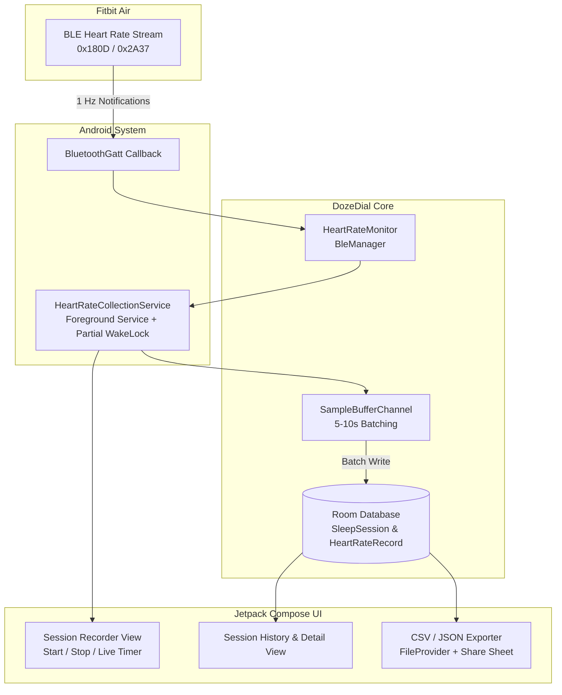

# Phase 2 Implementation Plan: Overnight Data Collection & Sleep Signal Feasibility Study

## 1. Goal Description

In Phase 1, we successfully established physical BLE communication with the Fitbit Air, streaming live heart rate data using the standard Bluetooth SIG Heart Rate Profile (`0x180D`). Physical testing confirmed that the Fitbit Air broadcasts live heart rate using the `UINT16` format without raw RR intervals in its standard broadcast mode.

**Phase 2 Objective**:
> Build a battery-efficient, background-resilient Android data collection pipeline to record 8+ hours of uninterrupted overnight heart rate data from the physical Fitbit Air into a local database and exportable CSV format, enabling empirical feasibility analysis for DozeDial's future smart-alarm sleep stage estimator.

---

## 2. User Review Required

> [!IMPORTANT]
> **Key Hardware Reality (from Phase 1 Verification)**:
> In physical testing, the Fitbit Air emits `UINT16` BPM with `0` RR intervals. Consequently, the Phase 2 analysis will evaluate whether continuous high-resolution BPM time-series dynamics (diurnal dips, sliding window variance, slope, and awakening spikes) provide sufficient signal to detect light sleep, deep sleep, and wake windows without requiring raw RR intervals.

> [!NOTE]
> **Foreground Service & Battery Optimization**:
> Recording continuous BLE data across 8 hours of sleep requires a Foreground Service with `foregroundServiceType="connectedDevice"`, a partial wake lock, and an ongoing notification. Battery drain must be kept minimal by buffering database writes (writing every 5–10 seconds rather than every packet).

---

## 3. Architecture & Data Flow



---

## 4. Proposed Changes

### Component 1: Room Database & Persistence Layer (`com.dozedial.data.db`)

We will add Android Room for local persistence. Room provides zero-network, high-performance structured storage.

#### [NEW] `SleepSessionEntity.kt`
Tracks metadata for each sleep recording session:
```kotlin
@Entity(tableName = "sleep_sessions")
data class SleepSessionEntity(
    @PrimaryKey(autoGenerate = true) val sessionId: Long = 0,
    val startTime: Long,          // Epoch millis
    val endTime: Long? = null,    // Epoch millis (null while recording)
    val deviceAddress: String,
    val deviceName: String?,
    val totalSamples: Int = 0,
    val avgBpm: Double? = null,
    val minBpm: Int? = null,
    val maxBpm: Int? = null,
    val notes: String? = null
)
```

#### [NEW] `HeartRateRecordEntity.kt`
High-resolution time-series data for each packet:
```kotlin
@Entity(
    tableName = "heart_rate_records",
    indices = [Index(value = ["sessionId", "timestampMs"])],
    foreignKeys = [
        ForeignKey(
            entity = SleepSessionEntity::class,
            parentColumns = ["sessionId"],
            childColumns = ["sessionId"],
            onDelete = ForeignKey.CASCADE
        )
    ]
)
data class HeartRateRecordEntity(
    @PrimaryKey(autoGenerate = true) val id: Long = 0,
    val sessionId: Long,
    val timestampMs: Long,
    val bpm: Int,
    val sensorContact: Boolean?,
    val energyExpended: Int?,
    val rawBytesHex: String
)
```

#### [NEW] `SleepSessionDao.kt` & `HeartRateRecordDao.kt`
- Efficient batch insertion: `@Insert(onConflict = OnConflictStrategy.REPLACE) suspend fun insertBatch(records: List<HeartRateRecordEntity>)`
- Query sessions, load time-series, and query summary statistics (`MIN`, `MAX`, `AVG`).

#### [NEW] `DozeDialDatabase.kt`
Room database setup with database singleton and schema migrations.

---

### Component 2: Background Collection Service (`com.dozedial.service`)

#### [NEW] `HeartRateCollectionService.kt`
- Implements Android Foreground Service.
- Declares `foregroundServiceType="connectedDevice"` in `AndroidManifest.xml` (Android 14+ requirement).
- Manages an ongoing notification:
  - Title: *"DozeDial Sleep Recording Active"*
  - Content: *"Live HR: 64 BPM • Session: 4h 12m"*
  - Action buttons: *"Stop & Save"* directly from the notification.
- Holds a `PowerManager.PARTIAL_WAKE_LOCK` with timeout safety to ensure Android Doze mode does not sleep the BLE GATT listener.
- Collects `HeartRateMonitor.samples` flow and buffers items into a coroutine channel, flushing to Room every 5 seconds or 50 samples to eliminate unnecessary I/O wakes.

---

### Component 3: CSV Export & Analysis Utility (`com.dozedial.export`)

#### [NEW] `SessionDataExporter.kt`
- Generates a standard CSV formatted for pandas / Excel / NumPy:
  ```csv
  session_id,iso_timestamp,timestamp_epoch_ms,elapsed_seconds,bpm,sensor_contact,raw_hex
  1,2026-10-05T00:15:23.104Z,1791168923104,0,68,true,01 44 00
  1,2026-10-05T00:15:24.110Z,1791168924110,1,67,true,01 43 00
  ```
- Uses Android `FileProvider` (`androidx.core.content.FileProvider`) to expose the file via standard Android Share Sheet (`Intent.ACTION_SEND`), allowing the user to email, Drive upload, or transfer the file to their PC with one tap.

---

### Component 4: UI Enhancements (`com.dozedial.ui`)

#### [MODIFY] `MainActivity.kt` & UI Screens
Add three clean tabbed / segmented views:
1. **Live & Record Tab**:
   - Device selector & connection status.
   - Large *"Start Overnight Recording"* / *"Stop Recording"* button.
   - Live session timer, current BPM, and packet count.
2. **History Tab**:
   - List of completed overnight sessions (Date, Duration, Sample count, Average/Min/Max BPM).
   - Tap a session to view the summary and an interactive heart rate curve.
3. **Session Detail & Export Dialog**:
   - Visual time-series graph of the entire night's BPM.
   - One-tap *"Export CSV"* button to export data for offline analysis.

---

## 5. Feasibility Analysis Plan (Offline / Data Science)

Once the first overnight session is recorded and exported as CSV, the dataset will be analyzed against established sleep physiology criteria:

| Physiological Signal | Expected Pattern in True Sleep | Feasibility Metric |
|---|---|---|
| **Sleep Onset Dip** | Heart rate drops by 5–15% within 15–30 minutes of lying down. | Measurable slope & stable resting heart rate (RHR). |
| **Deep (NREM) Sleep** | Low, ultra-stable heart rate with minimal fluctuations. | Windowed standard deviation $\sigma < 1.5$ BPM over 5-minute epochs. |
| **REM Sleep** | Elevated heart rate with higher frequency fluctuations. | Elevated mean BPM with episodic bursts. |
| **Wake Window Spikes** | Sharp, immediate heart rate elevation upon arousal/movement. | Positive gradient $> +5$ BPM within 10–20 seconds. |

---

## 6. Verification Plan

### Automated Tests
1. **Room DAO Unit Tests**:
   - In-memory SQLite tests verifying batch insertion speed (5000+ samples inserted in $<100$ms).
   - Querying session aggregates (`AVG`, `MIN`, `MAX`).
2. **CSV Exporter Unit Tests**:
   - Validating column formats, ISO timestamps, elapsed seconds calculation, and null handling.
3. **Build & Lint Verification**:
   - `./gradlew testDebugUnitTest`
   - `./gradlew assembleDebug`

### Manual Verification Steps
1. Put on Fitbit Air and start recording in DozeDial.
2. Lock phone screen for 10 minutes.
3. Unlock phone and confirm:
   - Notification was visible and updating throughout screen-off.
   - Zero dropped packets in that 10-minute test window.
4. Stop session, open History, and confirm session summary (sample count ~600 for 10 min).
5. Tap "Export CSV" and open the CSV on computer to verify all data rows are intact.
6. Run overnight during actual sleep.

---

## 7. How to Resume This Plan in the New Session

In your next session, you can prompt the agent:
> *"Implement Phase 2 of DozeDial according to the implementation plan at `docs/plans/phase_2_overnight_data_collection_plan.md`"*
