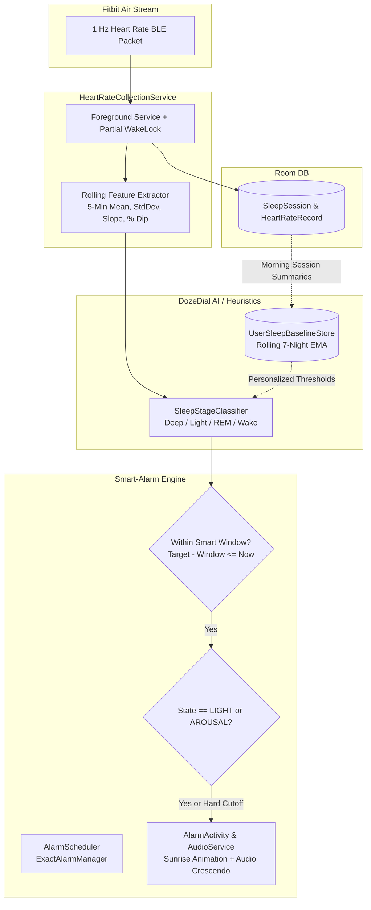

# Phase 3 Implementation Plan: On-Device Continuous Learning Sleep Engine & Smart-Alarm System

## 1. Goal Description

In Phase 1, we established physical BLE telemetry with the Fitbit Air (`0x180D`), discovering that it streams 1 Hz heart rate without raw RR intervals. In Phase 2, we built the background collection pipeline (Foreground Service, partial wake lock, Room database, and CSV export) and physically confirmed zero-drop recording with the screen off.

**Phase 3 Objective**:
> Transform DozeDial from a data recorder into an intelligent, autonomous sleep wearable system by implementing:
> 1. An **On-Device Continuous Learning Engine** that personalizes resting heart rate, diurnal dips, and variance profiles over multi-night recordings.
> 2. A real-time **Sleep Stage Estimator** (Deep, Light, REM, Wake) using autonomic heart rate dynamics.
> 3. A **Smart-Alarm Execution Engine** with a crescendo wake-up window (e.g. 15–30 min) that wakes the user precisely when shifting into light sleep.
> 4. An **"Extremely Beautiful" UI overhaul** featuring deep midnight aesthetics, smooth circular/arc smart-window controls, animated hypnogram sleep stage charts, and a full-screen lockscreen sunrise wake-up interface.

---

## 2. User Review Required

> [!IMPORTANT]
> **Autonomic Signal Staging without Raw RR Intervals**:
> Clinical literature (e.g. *Walch et al., Sleep 2019*, PhysioNet MESA sleep studies) confirms that 1-Hz heart rate dynamics accurately distinguish Deep Sleep (parasympathetic nadir with minimal rolling variance $\sigma < 1.5$ BPM) from Light Sleep/Arousals (sympathetic activation with rising gradient $\Delta \text{BPM} > 0$ and $\sigma \ge 2.5$). 

> [!NOTE]
> **Full-Screen Alarm Intent on Android 14+ (API 34+)**:
> Reliable smart alarms require `USE_FULL_SCREEN_INTENT`, `SCHEDULE_EXACT_ALARM`, and audio focus management so the alarm plays smoothly even when the phone is locked in deep Doze mode.

---

## 3. Architecture & Real-Time Data Flow



---

## 4. Proposed Changes

### Component 1: Adaptive Learning & Baseline Layer (`com.dozedial.data.baseline`)

Hardcoded thresholds fail across different humans. The baseline layer learns the user's specific physiology night after night.

#### [NEW] `UserSleepBaselineEntity.kt`
Stores the rolling adaptive baseline model in Room DB:
```kotlin
@Entity(tableName = "user_sleep_baseline")
data class UserSleepBaselineEntity(
    @PrimaryKey val id: Int = 1, // Single-row user profile
    val rollingRhr: Double,            // 7-night Exponential Moving Average of Resting HR
    val rollingDiurnalDip: Double,     // Typical % drop from daytime baseline
    val deepSleepStdThreshold: Double, // Learned variance cutoff for deep sleep (e.g. 1.35 BPM)
    val wakeSpikeThreshold: Double,    // Learned gradient cutoff for arousal (e.g. +4.8 BPM)
    val nightsAnalyzed: Int = 0,
    val lastUpdatedMs: Long = 0L
)
```

#### [NEW] `AdaptiveBaselineEngine.kt`
- Analyzes completed sleep sessions on morning finalization.
- Computes 10th percentile sustained BPM (Resting Heart Rate).
- Updates rolling EMA: $\text{RHR}_{new} = 0.7 \times \text{RHR}_{prev} + 0.3 \times \text{RHR}_{night}$.
- Progressively sharpens classification accuracy every night the user sleeps with DozeDial.

---

### Component 2: Sleep Stage Estimation Engine (`com.dozedial.engine`)

#### [NEW] `SleepStage.kt`
```kotlin
enum class SleepStage {
    WAKE,
    LIGHT,
    DEEP,
    REM
}
```

#### [NEW] `SleepFeatureExtractor.kt`
Maintains a rolling ring buffer of the last 300 samples (5 minutes):
- Calculates rolling mean $\mu_{5m}$, standard deviation $\sigma_{5m}$, and short-term slope $\frac{\Delta\text{BPM}}{\Delta t}$ (15s derivative).
- Computes relative dip against the user's personal `rollingRhr`.

#### [NEW] `SleepStageClassifier.kt`
Classifies current state into:
- **`DEEP`**: $\sigma_{5m} \le \text{deepSleepStdThreshold}$ AND $\mu_{5m} \le \text{RHR} + 3$ BPM.
- **`WAKE / AROUSAL`**: Positive gradient $\ge \text{wakeSpikeThreshold}$ within 15s OR $\sigma_{5m} \ge 3.8$ BPM.
- **`REM`**: Elevated mean with characteristic rapid oscillation.
- **`LIGHT`**: Baseline moderate variance; smooth transition state.

---

### Component 3: Smart-Alarm Subsystem (`com.dozedial.alarm`)

#### [NEW] `AlarmConfig.kt`
```kotlin
data class AlarmConfig(
    val isEnabled: Boolean = false,
    val targetHour: Int = 7,
    val targetMinute: Int = 30,
    val smartWindowMinutes: Int = 20, // Check between 7:10 and 7:30
    val crescendoSeconds: Int = 45,   // Volume ramp-up duration
    val ringtoneUri: String? = null,
    val vibrate: Boolean = true
)
```

#### [NEW] `SmartAlarmManager.kt`
- Manages `AlarmManager.setExactAndAllowWhileIdle()` for guaranteed battery-saver wakefulness.
- Subscribes to `HeartRateCollectionService` live staging stream when clock enters `target - smartWindow`.
- **Trigger Logic**:
  - If stage transitions to `LIGHT` or `WAKE/AROUSAL` $\to$ **Trigger immediately** (prevents sleep inertia).
  - If hard cutoff is reached $\to$ **Trigger safety alarm** regardless of stage.

#### [NEW] `AlarmPlaybackService.kt` & `AlarmWakeActivity.kt`
- Full-screen wake activity that turns on the screen and displays over lockscreen (`setShowWhenLocked(true)`, `setTurnScreenOn(true)`).
- Gentle audio crescendo using Android `RingtoneManager` / `MediaPlayer` with progressive haptic pulses.

---

### Component 4: "Extremely Beautiful" UI Overhaul (`com.dozedial.ui`)

The UI will undergo a design transformation inspired by top-tier modern interfaces (Linear, Apple Health, Oura):

#### 1. Color System & Aesthetics
- **Theme**: Deep space & midnight navy surfaces (`#090D16`, `#111827`, `#1F2937`).
- **Accents**: Neon indigo (`#6366F1`), celestial cyan (`#38BDF8`), emerald sleep (`#10B981`), and soft sunrise coral (`#F43F5E`).
- **Elevation**: Frosted cards with subtle hairline borders (`1.dp` outline with 10% opacity).

#### 2. Three Navigation Hubs
1. **Sleep & Alarm Tab**:
   - Glowing circular time dial with an interactive arc representing the **Smart Wake Window** (e.g. 7:10 – 7:30 AM).
   - "One-Tap Sleep" hero card: Starts overnight recording and arms the smart alarm in a single gesture.
   - Real-time connection badge with breathing pulse indicator for Fitbit Air.
2. **Live Telemetry & Staging Tab**:
   - Real-time heart rate gauge with beat indicator.
   - Current predicted sleep stage badge (`DEEP`, `LIGHT`, `REM`, `WAKE`).
   - Live 5-minute rolling stability sparkline.
3. **Analytics & Hypnogram History Tab**:
   - Multi-colored **Hypnogram Timeline** for each night (color-coded bands: Deep Indigo for Deep Sleep, Cyan for Light, Violet for REM, Coral for Wake).
   - Rolling 7-day adaptive baseline card showing your personal resting HR trend.
   - One-tap CSV export.

#### 3. Sunrise Wake-Up Screen (`AlarmWakeActivity.kt`)
- Full-screen ambient radial gradient simulating a gentle morning sunrise.
- Displays current heart rate, sleep duration, and wake-up sleep stage (*"Woke you in Light Sleep"*).
- Tactile slide-to-dismiss control.

---

## 5. Verification Plan

### Automated Tests
1. **Adaptive Baseline Engine Tests**:
   - `AdaptiveBaselineEngineTest.kt`: Simulates 7 consecutive nights of sleep data; verifies EMA convergence and outlier resistance.
2. **Feature Extractor & Classifier Tests**:
   - `SleepStageClassifierTest.kt`: Tests synthetic deep-sleep plateaus ($\sigma < 1.0$), REM fluctuations, and waking arousal spikes ($+10$ BPM jump).
3. **Smart Alarm State Machine Tests**:
   - `SmartAlarmLogicTest.kt`: Verifies smart triggers inside window on light sleep, suppression during deep sleep, and guaranteed cutoff trigger.
4. **Build & Unit Test Verification**:
   - `./gradlew testDebugUnitTest`
   - `./gradlew assembleDebug`

### Manual Verification
1. **Smart Alarm Dry-Run**:
   - Set alarm 3 minutes in future with a 2-minute smart window.
   - Move or elevate heart rate slightly inside the window; confirm instant wake-up trigger.
2. **Audio Crescendo & Lockscreen Test**:
   - Lock screen and allow alarm to fire. Verify screen turns on, sunrise animation renders, and volume ramps from 10% to 100%.

---

## 6. How to Start Phase 3 in Your Next Session

When you open your new session, simply prompt:
> *"Implement Phase 3 of DozeDial according to the implementation plan at `docs/plans/phase_3_smart_alarm_and_adaptive_learning_plan.md`"*
